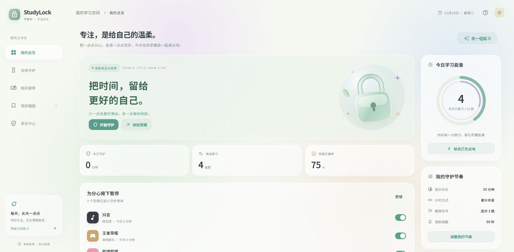
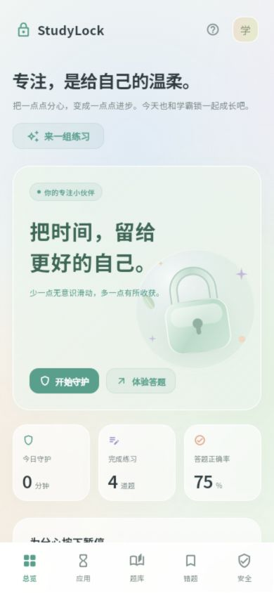

# 爱学习 (love learn)

把时间，留给更好的自己。基于需求说明和交互原型开发的 Flutter 应用，采用薄荷绿、雾紫、奶油白和蜜桃色的液态玻璃风格。

## 环境与运行

本次使用 Flutter **3.47.7 stable** / Dart **3.13.5** 开发与验证。依赖已锁定在 `pubspec.lock`，`.fvmrc` 提供同版本配置。稳定版本以 [Flutter 官方发布归档](https://docs.flutter.dev/install/archive) 为准。

```powershell
flutter pub get
flutter run -d chrome
# 或 Windows 桌面
flutter run -d windows
# 或已连接并授权的 Android 设备
flutter run
```

当前机器全局 SDK 目录不可写，工程内准备了被 Git 忽略的 `.tooling/flutter` 副本。本机可使用：

```powershell
.\scripts\flutter.ps1 run -d chrome
.\scripts\flutter.ps1 run -d windows
```

其他机器安装正常可写的 Flutter stable 即可，不依赖该本地副本。Windows 原生语音插件还需要 NuGet CLI 位于 PATH；本机副本已放在 `.tooling/bin`，项目 `NuGet.Config` 使用官方源。

## 已实现

- **自适应工作台**：手机底部导航、平板紧凑侧栏、桌面三栏总览，含今日统计、真实练习足迹与常驻守护策略。
- **液态玻璃界面**：实时背景模糊、通透渐变、高光描边、自绘玻璃锁插画和马卡龙配色。Noto Sans SC 字体随应用打包，中文显示不依赖远程字体服务。
- **应用管理**：分组、搜索、全选、累计 / 独立计时、各应用单独时长、提前提醒、通关条件和错题追加设置。
- **题库与导入**：3 本内置题库、28 道样例题；多题库混出，标签 / 难度筛选，JSON / CSV / ZIP 文件选择及 JSON 粘贴、校验预览和原子保存。
- **完整答题流程**：单选、多选、填空、系统 TTS 和本地音频听力，Fisher–Yates 洗牌，1–4 / Enter 快捷键，答错震动与 5 秒冷却，连续 / 累计通关、10 秒冷静后的每日紧急跳过。
- **错题联动**：自动加入、60% 错题优先抽取、权重更新、连续答对 3 次自动毕业。
- **应用密码**：首次自行设置，无内置默认密码；随机盐值 + PBKDF2-HMAC-SHA256（210000 次）派生，系统安全存储；打开应用和从后台返回时验证，当前会话内修改配置无需重复输入；连续错 5 次锁定 10 分钟。
- **本地数据**：Drift / SQLite、关系表与外键、事务保存、网页本地 WASM 数据库、保存失败提示及重试。
- **Android 原生桥接**：已安装应用、实际权限、无障碍监听、单调计时、悬浮提醒、拦截 Activity、设备管理引导和紧急拨号豁免。

**平台范围：** Android 原生管控代码需要完成真机权限与厂商系统验收；iOS、macOS、Windows 当前提供共享界面与学习功能，系统应用监控 / 防卸载尚未接入。完整说明见 [平台能力与验收](docs/platforms.md)。

## 构建与检查

```powershell
flutter analyze
flutter test --concurrency=1
flutter build web --no-web-resources-cdn --no-wasm-dry-run
flutter build windows --release
flutter build apk --release
flutter build apk --debug --target-platform android-arm64
```

本机可将上述命令的 `flutter` 换成 `.\scripts\flutter.ps1`。也可运行 `.\scripts\build_web.ps1`，将网页引擎资源一并放入构建目录。

网页产物在 `build/web/`，通过 HTTP 服务打开：

```powershell
python -m http.server 5173 --bind 127.0.0.1 --directory build/web
```

访问 http://127.0.0.1:5173 。同一网站来源下的练习与题库会保存在本地，清除网站数据会移除对应记录。

Android 签名目前使用调试配置。Windows 需分发整个 `build/windows/x64/runner/Release/` 目录，不能只复制 exe。

当前版本为 **1.0.2**（`versionCode: 3`），Release 构建产物：
- Android Release APK：`build/love-learn-1.0.2-android-release.apk`（及 `build/app/outputs/flutter-apk/app-release.apk`）
- Android 调试 APK：`build/love-learn-1.0.2-android-debug.apk`
- Windows Release 便携包：`build/love-learn-1.0.2-windows-x64-release.zip`（运行目录：`build/windows/x64/runner/Release/`）

应用标识与签名配置保持一致，可直接覆盖安装旧版并保留原密码与本地数据。

## 验证记录

30 项 Flutter 测试、5 项 Android 原生测试、代码检查与交互验证记录见 [验证说明](docs/verification.md)。

## 题库格式

```json
{
  "bank_name": "我的题库",
  "category": "general",
  "version": "1.0.0",
  "questions": [
    {
      "id": "q1",
      "type": "single_choice",
      "difficulty": 1,
      "stem": "1 + 1 = ?",
      "payload": { "options": ["2", "3", "4"], "shuffle": true },
      "answer": [0],
      "explanation": "1 + 1 = 2",
      "tags": "基础"
    }
  ]
}
```

`type` 支持 `single_choice`、`multi_choice`、`fill_blank`、`listening`。选择题答案为从 0 开始的下标；填空题答案为字符串数组，可用 `|` 分隔同义答案。听力使用 `audio_source: "tts:word"`，或 ZIP 中的 `file:media/word.mp3`。

CSV 表头为 `id,type,stem,options,answer,explanation,difficulty,tags,audio_source`。`options` 与选择题 `answer` 是 CSV 引号正确转义的 JSON 数组；填空题 `answer` 为文本。ZIP 根目录需要 `questions.json`，音频置于 `media/`；导入不会把 ZIP 路径直接写入文件系统。

## 目录

```text
lib/
  core/                 模型、Drift 数据库、Riverpod 状态、原生桥接
  features/dashboard/   总览、统计与成长足迹
  features/monitor/     应用管理和策略
  features/banks/       题库导入和错题本
  features/quiz/        答题状态机、听力和拦截 UI
  features/security/    PIN、安全存储和权限引导
  ui/                   自适应外壳、玻璃组件和主题
pigeons/                原生通信协议与生成配置
assets/banks/           三本内置题库
assets/fonts/           Noto Sans SC 及 SIL Open Font License
android/                Kotlin 原生监控与拦截
web/                    网页入口、SQLite WASM 和 Drift worker
scripts/                本机 Flutter 启动与网页构建
```

原始 `studylock.md` 与 `studylock_ui.html` 保留，作为需求和交互参考。

## 界面预览





